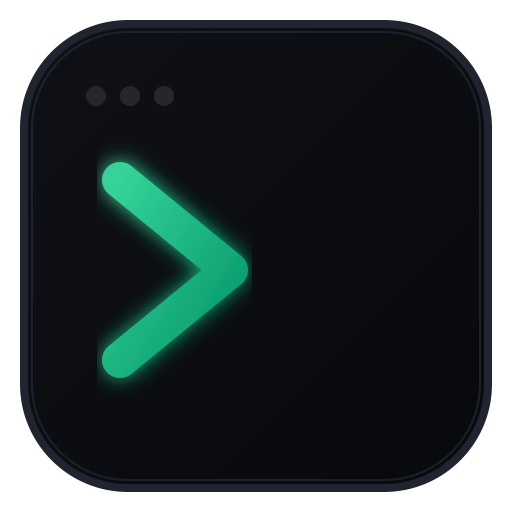

# NeoWork - Developer Workspace Orchestrator

<div align="center">

  

  <h3>A modern workspace orchestrator, terminal dashboard, and mobile companion for developers</h3>

  <p>
    Launch, organize, and monitor multiple terminals, AI coding agents, background services, and development processes in parallel, on an infinite canvas, with real-time telemetry and a remote mobile companion.
  </p>

  <p>
    <a href="https://github.com/neukkken/neo-workspace/releases"></a>
    <a href="LICENSE"></a>
    <a href="#"></a>
    <a href="#"></a>
  </p>
</div>

---

## Open Source Project

**NeoWork is free and open-source software** distributed under the terms of the **MIT License**.

Built around developer-first principles:
- **Local-first and Private:** Workspaces, notes, and terminal history stay on your local machine. No tracking and no remote telemetry.
- **No Vendor Lock-in:** Fork, audit, extend, or customize any module freely.
- **Community-Driven:** Contributions, feature proposals, and feedback from developers worldwide are welcomed and encouraged.

---

## Downloads and Installation

Precompiled binary packages are available directly from the **[Releases](https://github.com/neukkken/neo-workspace/releases)** page:

### Windows
- **Setup Installer:** `NeoWork-Setup-1.10.0.exe` (Recommended for automatic updates and desktop shortcuts).
- **Portable Executable:** `NeoWork-1.10.0.exe` (Run directly without installation or administrator privileges).

### Linux
- **Universal AppImage:** `NeoWork-1.10.0.AppImage` (Runs on all modern Linux distributions).
  ```bash
  chmod +x NeoWork-1.10.0.AppImage
  ./NeoWork-1.10.0.AppImage
  ```
- **Debian / Ubuntu Package:** `neowork_1.10.0_amd64.deb`
  ```bash
  sudo dpkg -i neowork_1.10.0_amd64.deb
  ```

---

## Key Features

### 1. Workspaces and Sidebar Launchpad
- Create one workspace per project. Each keeps its own canvas, cards, startup commands, and working directories.
- Switch with `Ctrl + 1..9`, the sidebar, or the command palette. The sidebar can sit on any edge of the window.
- Time per workspace: a timer in the title bar counts the time you spend in each one. It pauses after 5 minutes without keyboard or mouse input, unless an agent is still working there.
- Data is saved as JSON in the app data folder. Save manually with `Ctrl + S`.

### 2. Native Interactive Terminals
- Powered by `node-pty` and `@xterm/xterm` (v6) with 24-bit TrueColor, search (`Ctrl + F`), and clickable URLs.
- Choose the engine per card, or set a default in Settings: Command Prompt, Windows PowerShell, PowerShell 7, Git Bash, and WSL (WSL only when a distribution is installed). On Linux and macOS, the shells listed in `/etc/shells`.
- Bundled JetBrains Mono with box-drawing and block characters, so full-screen interfaces such as Claude Code keep their layout.
- Fully interactive: handles `Ctrl + C`, confirmation prompts, Git interactive rebases, Docker, Vite, and development CLI tools.
- Scrollback is restored when you reopen NeoWork: the last 120 KB of each terminal, above a "previous session" separator. The running process does not come back. The history is plain text in the app data folder, so anything printed there, including secrets, is stored too.
- `Ctrl + K` opens the command palette from inside a terminal.

### 3. Infinite Canvas
- Every workspace is an infinite board. Pan, and zoom from 35% to 220% anchored under the cursor. A minimap sits in the corner, and a toolbar button fits every card on screen.
- Cards:
  - **Console Cards:** Persistent terminals running in your project directory.
  - **Embedded Web Browsers:** Local previews (`http://localhost:5173`, etc.) with URL navigation, reload, and responsive presets.
  - **VS Code Cards:** A full VS Code instance, local or web.
  - **Sticky Notes:** Markdown-style notes with checkable tasks (`- [ ]`) and a progress bar. Connect a note to a console to send a task or a code block to it, or pull the console's latest output into the note.
  - **File Explorer Cards:** Browse directory trees, view code syntax, preview images, and inspect spreadsheet tables.
  - **Port Monitors:** Live status tracking for active local network ports.
  - **Git Session Cards:** See what changed in a repository during the current session (see section 4).
- Working with cards:
  - Double-click a card's header to focus it. Double-click again to go back to the previous view.
  - `Shift + click` or `Shift + drag` on empty canvas selects several cards. Drag them together, and press `Del` to delete them. Deleting asks first if an agent is working, and gives you 8 seconds to undo.
  - A card snaps when you drop it next to another card. Otherwise it stays where you put it.
  - Resize from any edge or corner. Press `Esc` or click empty canvas to clear the selection.

### 4. Git Session
- Shows what changed in each repository since its first terminal opened in the current run of NeoWork: commits, changed files, `+`/`−` totals, and a colored diff.
- Read-only: it never stages, commits, or changes your files or your stash list.
- "New session" resets the baseline. The session also ends when you close NeoWork.

### 5. Agent Activity Alerts
- A terminal that prints continuously for at least 15 seconds, then stays silent for 6 seconds, is marked as *finished or waiting for you*. It works with any agent that shows a spinner. NeoWork does not identify which program is running.
- Both cases look the same, so the alert says "finished or waiting for you".
- Alerts appear as a toast when the card's workspace is not active, as a badge on the sidebar, and in a bell that keeps the last 30 events. Clicking an event opens that exact card. When the window is in the background, NeoWork also sends a system notification and flashes the taskbar.
- Closing NeoWork while an agent is working shows which agents are running and asks before closing.

### 6. Mobile Companion & Remote Gateway
- Pair your smartphone or tablet by scanning a QR code. Zero app installation required: works in any modern mobile browser.
- Access is limited to local networks, Tailscale, and localhost. Every link carries a random token, and requests without it are rejected.
- The gateway uses plain HTTP. On a shared network, traffic is not encrypted. Use Tailscale to keep it private.
- **Remote AI Prompt Bar:** Send prompts to running AI coding agents from your phone while away from your desk.
- **Touch-Friendly Terminal Monitor:** Smooth touch-swipe scrolling and clean ANSI terminal log viewing on mobile displays.
- Quick action controls (Enter, Ctrl+C, Clear) and real-time CPU/RAM telemetry on your mobile screen.

### 7. Command Palette (`Ctrl + P` / `Ctrl + K`)
- Fast keyboard-centric navigation across your entire environment.
- Switch workspaces, restart the active workspace, toggle the sidebar, open settings, or add a card to the canvas (console, browser, VS Code, note, file explorer, port monitor, or Git session).

### 8. Integrated File Explorer & Excel Viewer
- Browse project files with smart file icons and hidden file filtering.
- Full spreadsheet preview support (`.xlsx`, `.xls`, `.csv`) with tabulated sheet viewer, search filter, and "Open in System App" shortcut.
- Embedded preview for Markdown, JSON, source code, and images.

### 9. Real-Time Telemetry & Process Monitoring
- Live **CPU %** and **RAM (MB)** per terminal. On Windows, NeoWork measures the whole process tree of each terminal, so an agent or dev server started inside a shell is counted. Elsewhere it measures only the shell process.
- Aggregated workspace and system load in the title bar.

### 10. Built-in Silent Auto-Updater
- Integrated with GitHub Releases via `electron-updater`.
- Checks for updates automatically and notifies you with a non-intrusive toast to download and apply the latest version when ready.

### 11. Wallpapers and Themes
- Built-in wallpapers, or your own image (up to 40 MB).
- Terminal color themes: Midnight, Matrix, Dracula, Tokyo, Monokai, and Nord.

### 12. Keyboard Shortcuts
- Press `?` or click the shortcuts icon in the header to view the full interactive reference.

| Shortcut | Action |
| :--- | :--- |
| `Ctrl + K` / `Ctrl + P` | Command palette |
| `Ctrl + N` | New workspace |
| `Ctrl + B` | Show or hide the sidebar |
| `Ctrl + 1..9` | Switch workspace |
| `Ctrl + S` | Save workspaces |
| `Ctrl + Shift + R` | Restart the active workspace's terminals |
| `Ctrl + F` | Search in the active terminal |
| `Ctrl + Shift + C` / `V` / `A` | Copy, paste, select all in a terminal |
| `Esc` | Close the open modal, or clear the canvas selection |

---

## Visual Identity and Icon Options

NeoWork includes minimal design assets tailored for development tools:

| Option | Name | Concept | Asset File |
| :---: | :---: | :--- | :--- |
| **A** | **Matrix Minimal (Active)** | Matte carbon squircle featuring a luminous emerald terminal prompt glyph (`>_`). | [`resources/icon-matrix-minimal.svg`](resources/icon-matrix-minimal.svg) |
| **B** | **Neo Grid** | Minimal geometric 2x2 grid representing workspace nodes and telemetry states. | [`resources/icon-neo-grid.svg`](resources/icon-neo-grid.svg) |
| **C** | **Neo Monogram** | Stylized letter 'N' composed of terminal chevrons and cursor pillars. | [`resources/icon-neo-monogram.svg`](resources/icon-neo-monogram.svg) |

---

## Local Development

To run or build the project from source:

### Prerequisites
- [Node.js](https://nodejs.org/) version 24 recommended (the tests need 22.18 or newer)
- `npm` or `pnpm`
- C++ build tools for compiling `node-pty`:
  - **Linux (Ubuntu/Debian/Fedora):** `sudo apt install build-essential python3` / `sudo dnf groupinstall "Development Tools"`
  - **Windows:** Visual Studio C++ build tools

### Setup

1. **Clone the repository:**
   ```bash
   git clone https://github.com/neukkken/neo-workspace.git
   cd neo-workspace
   ```

2. **Install dependencies:**
   ```bash
   npm install
   ```

3. **Run in development mode (with HMR):**
   ```bash
   npm run dev
   ```

4. **Run TypeScript type verification:**
   ```bash
   npm run typecheck
   ```

5. **Run the tests:**
   ```bash
   npm test
   ```
   CI runs them on Windows only.

6. **Build bundle:**
   ```bash
   npm run build
   ```

7. **Package executables locally:**
   ```bash
   # Package for current host OS:
   npm run dist

   # Windows target (installer and portable, written to dist/):
   npm run dist:win

   # Linux target:
   npm run dist:linux
   ```

---

## Project Architecture

```
neo-workspace/
├── .github/
│   └── workflows/
│       └── release.yml               # CI: typecheck, tests (Windows), installers and GitHub release on v* tags
├── build/                            # App packaging icons (.png, .ico)
├── resources/                        # Vector design assets (SVG)
├── src/
│   ├── main/                         # Electron main process
│   │   ├── index.ts                  # Window, IPC, and app lifecycle
│   │   ├── pty-manager.ts            # Terminal processes (node-pty)
│   │   ├── shells.ts                 # Detects the shells installed on this machine
│   │   ├── agent-activity.ts         # Detects terminals that finished or wait for you
│   │   ├── telemetry.ts              # CPU and RAM per terminal and for the system
│   │   ├── process-tree.ts           # Process tree measurement (Windows)
│   │   ├── terminal-history.ts       # Keeps each terminal's scrollback between runs
│   │   ├── git-branches.ts           # Repository discovery and branch info
│   │   ├── git-session.ts            # Changes since a terminal first opened (read-only)
│   │   ├── workspace-clock.ts        # Time per workspace, paused when idle
│   │   ├── remote-gateway.ts         # Mobile companion HTTP and WebSocket server
│   │   ├── remote-access.ts          # Address and token checks for the gateway
│   │   ├── vscode-manager.ts         # Local and web VS Code instances
│   │   ├── wallpapers.ts             # User wallpaper store
│   │   ├── store.ts                  # Workspace JSON persistence
│   │   └── updater.ts                # In-app GitHub auto-updater service
│   ├── preload/
│   │   ├── index.ts                  # Secure ContextBridge IPC layer
│   │   └── index.d.ts                # TypeScript definitions for window.neoAPI
│   └── renderer/
│       ├── index.html                # HTML root
│       └── src/
│           ├── main.tsx              # React entry point
│           ├── App.tsx               # Root component and state synchronization
│           ├── types.ts              # Shared TypeScript schemas
│           ├── components/           # UI components
│           │   ├── CanvasWorkspace.tsx      # Infinite board: cards, selection, drag, resize
│           │   ├── CanvasToolbar.tsx        # Bottom toolbar: add cards, zoom, fit all
│           │   ├── CanvasConnectors.tsx     # Links between cards
│           │   ├── CanvasMinimap.tsx        # Minimap of the board
│           │   ├── CardResizeHandles.tsx    # Resize from any edge or corner
│           │   ├── TerminalCanvasCard.tsx   # Console card
│           │   ├── BrowserCard.tsx          # Embedded browser card
│           │   ├── VSCodeCard.tsx           # VS Code card
│           │   ├── NoteCard.tsx             # Sticky notes with tasks
│           │   ├── FileExplorerCard.tsx     # File explorer & spreadsheet viewer
│           │   ├── PortMonitorCard.tsx      # Active network port monitor
│           │   ├── GitCard.tsx              # Git session changes
│           │   ├── XTermView.tsx            # xterm.js instance with search & web-links
│           │   ├── ActivityCenter.tsx       # Bell with recent agent events
│           │   ├── AgentToasts.tsx          # Agent finished/waiting alerts
│           │   ├── Launchpad.tsx            # Sidebar workspace switcher
│           │   ├── TitleBar.tsx             # Title bar with system metrics & quick tools
│           │   ├── WorkspaceHeader.tsx      # Workspace controls & breadcrumbs
│           │   ├── WorkspaceModal.tsx       # Workspace editor modal
│           │   ├── CommandPaletteModal.tsx  # Command palette (Ctrl+K / Ctrl+P)
│           │   ├── SettingsModal.tsx        # App and gateway preferences
│           │   ├── ShortcutsModal.tsx       # Hotkeys cheat-sheet
│           │   ├── MobileConnectModal.tsx   # QR code pairing modal
│           │   ├── UpdateNotificationToast.tsx # Silent updater alert
│           │   └── Tooltip.tsx
│           ├── hooks/                # useAgentActivity, useGlobalShortcuts
│           ├── services/             # terminal-pool.ts: terminals kept alive across views
│           ├── utils/                # Canvas grid, card factory, note markup, palette, time, URLs
│           └── styles/
│               └── index.css         # Tailwind CSS definitions
├── tests/                            # node:test suites for main-process and utility logic
├── electron.vite.config.ts           # Bundling configuration (Electron + Vite)
├── electron-builder.json             # Cross-platform installer specifications
├── LICENSE                           # MIT Open Source License
└── package.json
```

---

## Contributing

Contributions are welcome. To contribute:

1. Fork the repository.
2. Create a feature branch (`git checkout -b feat/your-feature-name`).
3. Commit your changes using conventional commit style (`git commit -m 'feat: describe change'`).
4. Push to your branch (`git push origin feat/your-feature-name`).
5. Open a Pull Request against `master`.

---

## License

This project is licensed under the terms of the **MIT License**. See the [LICENSE](LICENSE) file for details.
